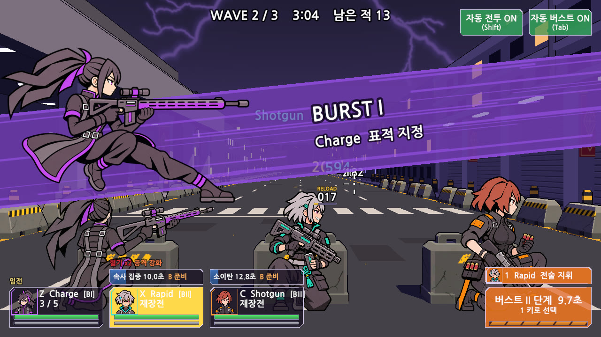
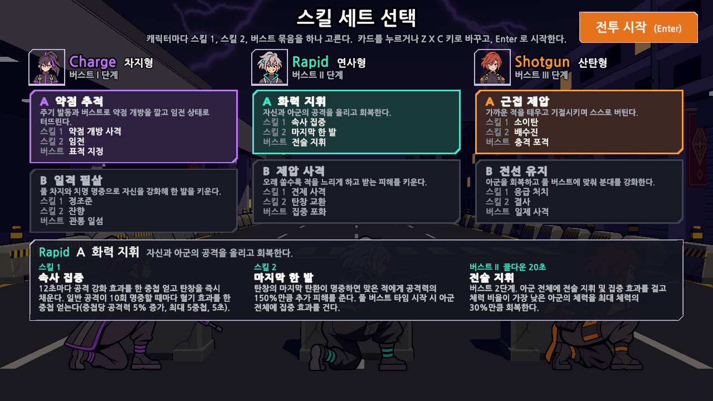
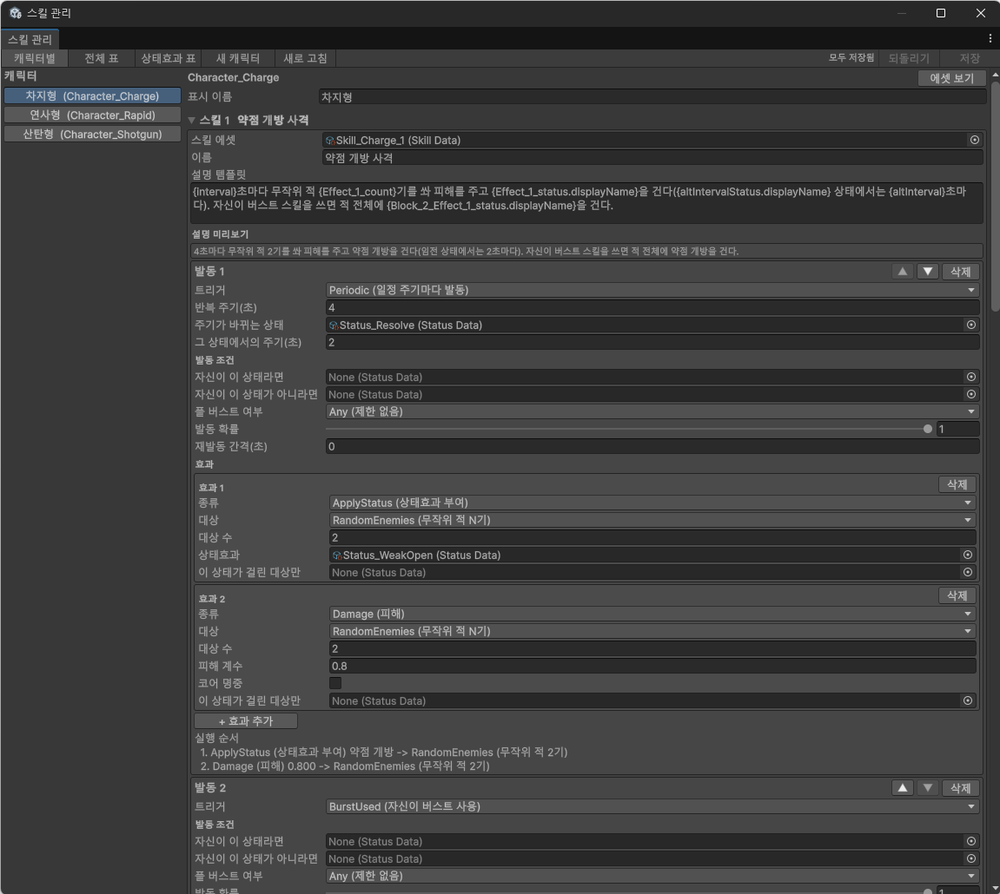
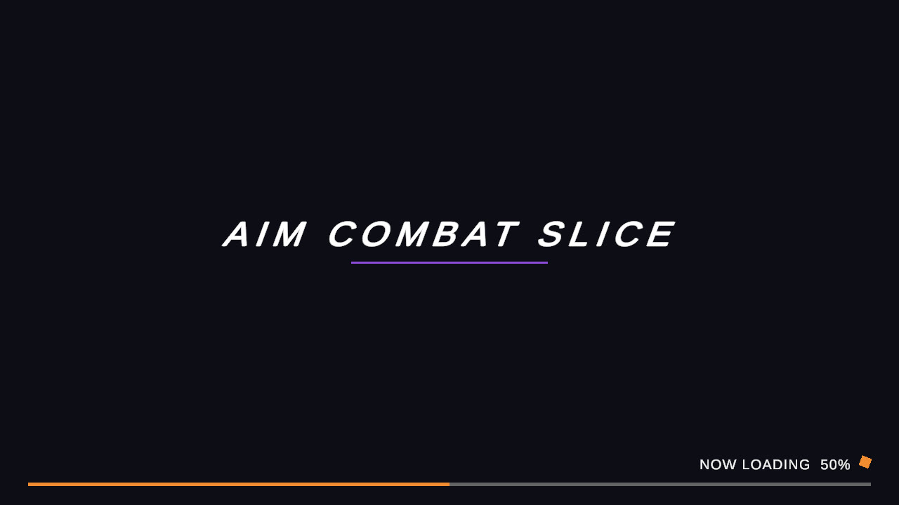
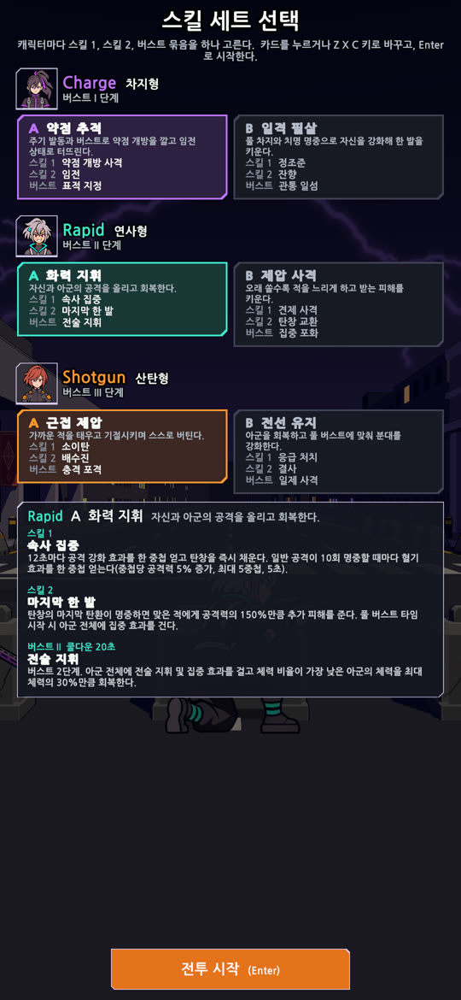
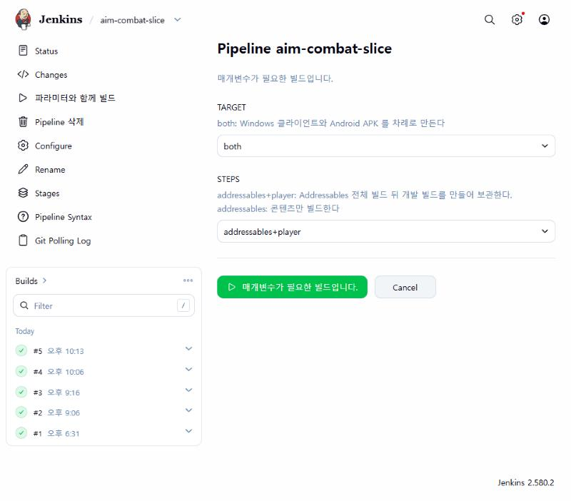
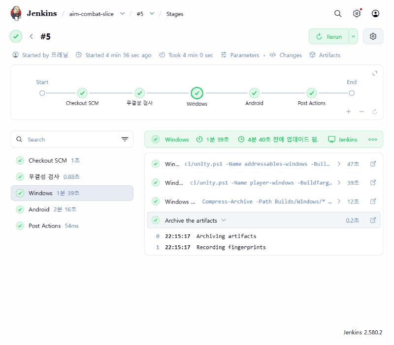
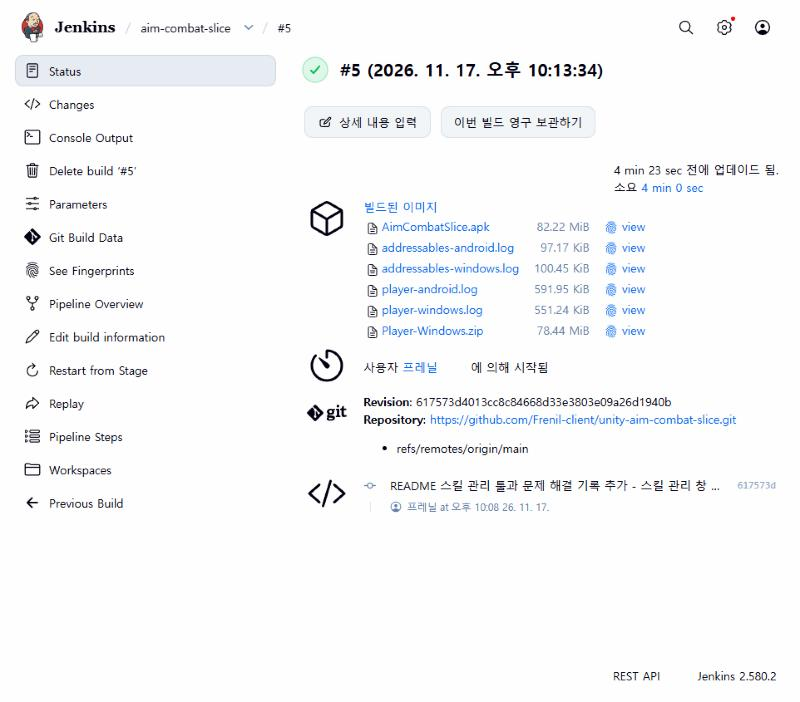

# Aim Combat Slice

**승리의 여신: 니케(NIKKE)의 전투를 레퍼런스로** 만든 Unity 전투 클라이언트 프로토타입입니다. 엄폐 뒤에서 조준해 쏘는 3인 분대 전투 한 판에 조준과 무기 3종, 스킬과 단계형 버스트(I, II, III, 풀 버스트), 버프와 상태효과, 보스 부위 파괴와 패턴 저지, 타격감 연출을 넣었습니다. 니케처럼 아군은 2D 일러스트, 적과 배경은 3D입니다.

니케의 전투 메커니즘(엄폐 사격, 버스트 연계, 자동 전투, 보스 부위 파괴)과 화면 구성 방식을 따랐고, 캐릭터, 적, 배경, 이름, 디자인은 모두 자체로 만들었습니다.


| 전투 (PC 가로) | 전투 (휴대폰 세로) |
|---|---|
|  |  |

| 버스트 컷인 | 스킬 세트 선택 |
|---|---|
|  |  |

## 한 판의 구성

```text
Boot(로딩 화면) → 전투 씬 → 스킬 세트 선택 → 웨이브 1, 2 → 보스 등장 연출 → 보스전 → 결과(누르거나 R 키로 다시 시작)
```

- 아군 3명(차지형, 연사형, 산탄형)이 엄폐물 뒤에 있고, 고른 한 명을 직접 조준해 쏩니다. 나머지는 스스로 대상을 골라 쏩니다.
- 적은 다가와 엄폐물을 때리는 돌격형, 멀리서 쏘는 원거리형, 마지막 웨이브의 보스입니다.
- 승리는 제한 시간 안의 보스 처치, 패배는 아군 전원 전투 불능 또는 시간 초과입니다.

## 구현한 것

| 영역 | 내용 | 코드 |
|---|---|---|
| 조준과 사격 | 마우스와 터치 드래그를 같은 입력 계층으로 받습니다. 무기마다 사격 방식(연사 퍼짐, 차지 충전과 관통, 산탄 다발), 재장전, 엄폐가 다릅니다. 조준점은 무기별 모양과 잔탄을 함께 그립니다 | [Input](Assets/_Project/Scripts/Input), [Weapons](Assets/_Project/Scripts/Weapons), [Squad](Assets/_Project/Scripts/Squad) |
| 피해 계산과 상태효과 | 계산은 엔진에 의존하지 않는 Core 어셈블리에 있습니다. 고정소수점과 결정적 난수로 같은 입력이면 같은 결과가 나옵니다. 상태효과는 중첩, 갱신, 최댓값, 지속 피해, 행동 불가와 보스 저항 게이지 규칙을 따릅니다 | [Core](Assets/_Project/Scripts/Core) |
| 스킬과 버스트 | 캐릭터마다 스킬 1, 스킬 2, 버스트 묶음 2세트를 데이터 에셋으로 두고 전투 전에 고릅니다. 버스트는 캐릭터 고유 단계(I, II, III)를 차례로 쓰고 III 단계에서 풀 버스트로 넘어갑니다. 두 번째 세트는 코드 수정 없이 데이터만으로 만들었습니다 | [Skills](Assets/_Project/Scripts/Core/Combat/Skills), [Data](Assets/_Project/Data) |
| 보스 | 탄막, 강타 예고와 돌진, 그로기 패턴. 양팔은 체력과 손상 단계가 있어 부서지고, 강타 예고 때 저지 표적을 모두 깎으면 패턴이 취소됩니다 | [Battle](Assets/_Project/Scripts/Battle) |
| 타격감 | 히트스톱, 카메라 흔들림, 툰 셰이더에 통합한 피격 플래시, 명중 불꽃과 탄피, 피해 숫자. 무기별 프리셋 에셋으로 조절하고 F1 튜닝 패널(에디터)에서 실행 중에 바꿔 저장합니다. F2 로 연출을 끄면 같은 장면을 연출 없이 볼 수 있습니다 | [Feel](Assets/_Project/Scripts/Feel) |
| 연출 | 버스트 컷인과 보스 등장 연출은 Timeline 에셋 하나씩이 움직임을 정하고 코드는 그림, 글, 색만 넣습니다. 보스 등장 중에는 게임 시간을 멈추고 카메라가 보스를 비춥니다 | [BurstCutIn](Assets/_Project/Scripts/Feel/BurstCutIn.cs), [BossIntro](Assets/_Project/Scripts/Feel/BossIntro.cs) |
| UI 와 해상도 | UI 스택(화면, 팝업, 공유 Dim)은 [unity-ui-system](https://github.com/Frenil-client/unity-ui-system) 패키지를 씁니다. 캔버스의 짧은 변을 늘 1080 으로 맞추고, 안전 영역 아래에서 가로형과 세로형 배치를 바꿉니다 | [UI](Assets/_Project/Scripts/UI) |
| 리소스 관리 | 씬, 캐릭터, 적, 데이터, UI 팝업을 Addressables 로 불러옵니다. 씬마다 필요한 리소스 목록을 두고, 씬을 옮길 때 다음 씬이 쓰는 것은 남기고 나머지만 반환합니다. 다시 시작은 다시 불러오지 않습니다 | [Content](Assets/_Project/Scripts/Content) |
| 빌드 | Jenkins 파이프라인이 무결성 검사, 플랫폼별 Addressables 빌드, Windows 개발 빌드와 APK 를 만듭니다 | [Jenkinsfile](Jenkinsfile), [ci](ci) |

## 스킬 데이터와 관리 툴

스킬은 코드가 아니라 데이터 에셋(ScriptableObject)입니다. 스킬 하나는 발동 블록(언제, 어떤 조건에서)과 효과(무엇을, 어떤 순서로)의 목록이고, 캐릭터 에셋이 스킬 1, 스킬 2, 버스트 세 칸을 세트별로 가집니다. 효과에서 쓰는 버프와 상태효과도 각각 에셋입니다.

**스킬 관리 창**(메뉴 **Aim Combat ▸ 스킬 관리**, [SkillManagerWindow](Assets/_Project/Scripts/Data/Editor/SkillManagerWindow.cs))



위 화면은 차지형의 스킬 1입니다. "4초마다(임전 상태에서는 2초마다) 무작위 적 2기에게 약점 개방을 걸고 피해를 준다"를 코드 없이 발동 블록(주기 4초, 상태에 따라 2초)과 효과 두 개(상태효과 부여, 피해 0.8배)로 조합했습니다. 아래의 실행 순서는 전투에서 효과가 실제로 처리되는 단계 순서이고, 설명 미리보기는 템플릿의 자리표시자를 지금 값으로 채운 문장입니다.

| 기능 | 내용 |
|---|---|
| 조합으로 만드는 스킬 | 트리거(주기, 전투 시작, 버스트 사용, 풀 버스트 시작과 끝, 명중, 약점 명중, 마지막 탄, 재장전, 처치, 피격, 체력 이하 등), 발동 조건(자신의 상태, 풀 버스트 여부, 확률, 재발동 간격), 효과(피해, 상태효과 부여와 해제, 회복, 탄약 채우기)를 골라 쌓는다. 발동과 효과를 추가, 삭제, 순서 변경한다 |
| 설명 문장 자동 생성 | 설명 템플릿의 `{interval}`, `{Effect_1_count}` 같은 자리표시자를 에셋 값으로 채운다. 수치를 바꾸면 게임 안 설명이 따라 바뀌어 설명과 실제 동작이 어긋나지 않는다 |
| 저장 전 검증 | 고친 내용은 창 안에만 머물고 저장할 때 에셋에 적용된다. 저장 전에도 Core 의 `SkillValidator` 로 검증한다. 실행 중 로드와 같은 규칙이라 여기서 통과하면 게임에서도 같은 판정을 받는다 |
| 새로 만들기 | 빈 칸에서 스킬 에셋을, 목록에서 캐릭터와 상태효과 에셋을 바로 만든다 |
| 전체 표, 상태효과 표 | 모든 캐릭터의 발동 블록, 버프와 상태효과의 중첩 규칙과 지속 시간, 수치를 한 표로 보고 비교한다. 줄을 누르면 그 편집 화면으로 간다 |

**만들고 바로 확인하는 흐름**

1. 스킬 관리 창에서 발동과 효과를 조합하고 저장한다.
2. 전투를 실행하면 시작 전 스킬 세트 선택 화면에서 캐릭터마다 A, B 세트를 골라 조합을 바꿔 본다.
3. 실행 중에 수치를 고치면 진행 중인 전투에 바로 반영된다. 에셋이 바뀌면 `OnValidate` 가 전투가 쓰는 Core 정의를 그 자리에서 고치기 때문이다(SPEC Q10). 발동이나 효과를 더하고 뺀 구성 변경은 R 로 다시 시작하면 새 구성으로 등록된다.

스킬, 캐릭터, 상태효과 에셋의 인스펙터도 같은 검증 결과와 요약을 보여 줍니다([CombatDataEditors](Assets/_Project/Scripts/Data/Editor/CombatDataEditors.cs)). 두 번째 스킬 세트(B 세트, 스킬 9종)는 이 툴과 데이터 구조만으로 코드 수정 없이 추가했습니다.

타격감 값은 무기별 프리셋 에셋에 있고, 에디터에서 F1 튜닝 패널을 열면 실행 중에 슬라이더로 바꿔 바로 보고 에셋에 저장합니다. 패널은 에셋의 공개 필드를 읽어 만들어서 프리셋에 값을 더해도 패널 코드를 고치지 않습니다.

## 리소스를 불러오는 방식

빌드 설정에는 `Boot` 씬 하나만 있습니다. Boot 가 Addressables 를 준비하고 전투 씬을 주소로 엽니다. 전투 씬에는 배경과 관리자(분대, 전투 감독, HUD)만 꺼진 채 저장돼 있고, 씬이 열리면 캐릭터와 적, 데이터를 꽂은 뒤 켜집니다.

| 씬 | 기초 리소스 목록 |
|---|---|
| 전투(`Battle`) | 캐릭터 프리팹 3개(계속 유지), 스킬 구성, 얼굴과 컷인 그림, 적 3종, 타격감 데이터 |
| 사격장(`SampleScene`) | 캐릭터 프리팹 3개(계속 유지) |

에디터에서 처음 실행, 다시 시작, 사격장 전환을 차례로 돌린 결과입니다.

| 단계 | 로딩 화면 | 새로 불러옴 | 보유 |
|---|---|---|---|
| 처음 실행(Boot → 전투) | 뜸 | 20개 | 19개 |
| 다시 시작(전투 → 전투) | 안 뜸 | 0개 | 19개 |
| 사격장으로(전투 → 사격장) | 안 뜸 | 0개 | 3개(16개 반환) |



로딩 화면은 앱 본체에 들어가는 Boot 씬에 있어 번들 리소스를 쓰지 않습니다. 그룹은 Scenes, Characters, Enemies, Data, UI, Shared(글꼴, 셰이더, HUD 그림, 배경) 여섯 개이고 모두 앱에 들어가는 로컬 그룹입니다. 배포 설정과 빌드 검사는 [unity-lobby-flow](https://github.com/Frenil-client/unity-lobby-flow) 의 `com.frenil.addressables-delivery` 패키지를 씁니다.

## 해상도 대응

| 가로형 | 세로형 |
|---|---|
|  |  |

- 캔버스 배율은 화면 방향에 따라 기준 해상도를 돌려, 가로든 세로든 짧은 변이 1080 입니다.
- 안전 영역의 가로세로 비가 1.3 보다 작으면 세로형 배치를 씁니다. 아군 열은 아래 가운데, 버스트 열은 그 위 오른쪽, 스킬 세트 선택은 열을 아래로 쌓고 끌어서 내려 봅니다.
- 세로 화면에서는 카메라가 가로 화각 34도를 지키도록 세로 화각을 넓힙니다(최대 68도).

## 실행

**빌드 파일로 바로 해 보기**: [Release](Release) 폴더에 Jenkins 로 만든 개발 빌드가 있습니다.

| 파일 | 대상 |
|---|---|
| [AimCombatSlice-Windows.zip](Release/AimCombatSlice-Windows.zip) | Windows 64비트. 압축을 풀고 `AimCombatSlice.exe` 실행 |
| [AimCombatSlice.apk](Release/AimCombatSlice.apk) | Android(ARM64). 블루스택에서 가로, 세로 모드로 확인 |

**에디터에서 실행**: Unity 6000.3.9f1(URP)에서 프로젝트를 열고 `Assets/Scenes/Boot.unity` 를 실행합니다. 전투 씬(`Battle.unity`)을 바로 실행해도 되며, 이때는 로딩 화면 없이 씬이 스스로 리소스를 불러옵니다.

| 조작 | 키 | 터치 |
|---|---|---|
| 조준, 사격 | 마우스 누른 채 이동 | 드래그 |
| 아군 전환 | Z, X, C | 아군 초상 |
| 버스트 | 숫자 1-5(후보 순서), Q(첫 후보) | 후보 버튼 |
| 자동 전투, 자동 버스트 | 왼쪽 Shift, Tab | 화면 위 버튼 |
| 연출 켜고 끄기, 튜닝 패널(에디터) | F2, F1 | |
| 다시 시작(결과 화면) | R | 화면 아무 곳 |

에디터에서 실행 파일을 직접 만들 때는 **Tools ▸ Addressables Delivery ▸ 빌드 창**에서 Addressables 를 먼저 빌드합니다. 플레이어 빌드가 Addressables 를 함께 빌드하지 않도록 설정돼 있습니다.

## 빌드 자동화(Jenkins)

개발 PC 에 설치한 Jenkins 가 GitHub `main` 의 [Jenkinsfile](Jenkinsfile)을 읽어 Addressables 빌드, Windows 클라이언트, Android APK 를 만듭니다. Jenkinsfile 과 `ci/` 스크립트는 [unity-lobby-flow](https://github.com/Frenil-client/unity-lobby-flow) 의 배포 패키지가 내보내는 CI 템플릿에서 시작해, 이 프로젝트에 맞게 원격 업로드와 콘텐츠 업데이트 단계를 뺐습니다.

| 빌드 실행(파라미터) | 단계 진행(#5) |
|---|---|
|  |  |



빌드 #5 는 `main` 의 최신 커밋을 받아 무결성 검사, Windows(1분 39초), Android(2분 16초)를 거쳐 약 4분 만에 APK, Windows zip, 단계별 Unity 로그를 보관했습니다. [Release](Release) 폴더의 두 파일이 이 빌드의 산출물입니다.

| 단계 | 하는 일 |
|---|---|
| 무결성 검사 | [ci/integrity.ps1](ci/integrity.ps1). Unity 를 띄우지 않고 저장소만 본다. JSON 카탈로그 심볼, 빌드 도중 상태(`preloadedAssets`, `link.xml`)가 커밋되지 않았는지, 동적 폰트를 비워 저장했는지, 셰이더 디버그 정보, 업로드 키 유출 |
| Windows | Addressables 전체 빌드(로컬 그룹) → 개발 빌드 → zip 보관 |
| Android | Addressables 전체 빌드 → 개발 빌드(APK) → 보관 |

- `main` 에 커밋이 올라오면 15분 안에 폴링으로 무결성 검사만 돈다. 빌드는 **파라미터와 함께 빌드**에서 `TARGET`(both, Windows, Android)과 `STEPS`(addressables+player, addressables)를 골라 실행한다.
- Unity 는 [ci/unity.ps1](ci/unity.ps1)이 배치 모드로 한 번씩 띄우고, 단계별 로그를 `ci-logs/` 에 남겨 Jenkins 가 보관한다.
- 플레이어 빌드는 Addressables 결과가 같은 플랫폼, 같은 프로필로 만들어졌는지 확인하고 아니면 거부한다(배포 패키지의 빌드 검사).

Jenkins 설치(서비스 계정, 포트), 에이전트 레이블과 Unity 경로 설정, 파이프라인 작업 등록은 lobby-flow 의 [Jenkins 설치와 등록](https://github.com/Frenil-client/unity-lobby-flow/blob/main/docs/guides/jenkins-setup.md)과 [새 프로젝트에 붙이기 8절](https://github.com/Frenil-client/unity-lobby-flow/blob/main/docs/guides/new-project-setup.md)과 같은 순서로 했습니다. 이 프로젝트는 같은 PC 의 같은 Jenkins 에 작업(`aim-combat-slice`)만 하나 더 등록했습니다.

## 문제를 좁힌 과정

PLAN 과 SPEC 의 첫 내용은 기준을 잡은 초안이고, 그 뒤 작업하면서 바뀌거나 더해진 것은 이유와 함께 [문제와 해결 기록](docs/problem-solving.md)에 문제(또는 니즈), 해결, 결과로 남겼습니다. 대표 사례입니다.

| 문제/니즈 | 해결 | 결과 |
|---|---|---|
| 세로 휴대폰에서 캔버스 폭이 486 이 되어 HUD 가 넘침. UI 시스템이 팝업을 열 때마다 배율 설정값을 다시 씀 | 설정값은 두고 화면 방향에 따라 기준 해상도를 돌려 계산하는 `CanvasScaler` 하위 클래스. 가로형, 세로형 배치 전환 | 1080x2340 과 블루스택 가로, 세로에서 확인 |
| 적이 움직이다 등을 보임 | 몸체와 모든 뼈의 회전을 재서 애니메이션(12도)이 아니라 몸체 회전(180도)이 원인임을 확인. 아군 쪽 기준으로 기울기만 허용 | 보스 7도, 돌격형 15도 안쪽 |
| 다시 시작할 때마다 로딩 화면이 뜸. 리소스를 씬이 소유해 매번 반환하고 다시 받음 | 씬별 기초 리소스 목록과 씬을 옮겨도 남는 보관소. 다음 씬이 쓰는 것만 남기고 반환 | 다시 시작 로드 0개, 사격장 전환 16개 반환 |
| 결과 화면 클릭에 반응 없음 | 공유 Dim 때문에 사격 입력이 클릭을 UI 위로 보고 뺀 것이 원인. 팝업이 직접 클릭을 받게 함 | 클릭이 다시 시작 칸에 닿고 0.03초 만에 재시작 |
| 나눔고딕이 앱 본체와 번들에 두 벌 | TMP 기본 글꼴(Resources)이 원인. 기본 글꼴을 영문 기본으로 되돌림 | 실행 파일 검사로 번들에만 있는 것 확인 |

## 확인한 범위

| 대상 | 확인 결과 |
|---|---|
| 에디터 자동 플레이 | 가로, 세로(1080x2340) 화면에서 한 판(웨이브 2개와 보스) 승리까지 오류 0 |
| Android | Jenkins 로 만든 APK 를 블루스택(Android 에뮬레이터)에서 가로, 세로 모드로 플레이 |
| Windows | 개발 빌드에서 Boot, 로딩, 전투 씬 준비 완료까지 오류 없음(로그) |
| Jenkins | 무결성 검사, Windows 와 Android 의 Addressables 빌드와 플레이어 빌드, 산출물 보관 |
| 리소스 수명 | 처음 실행, 다시 시작, 사격장 전환의 로드와 반환 수(위 표) |

## 재사용한 패키지와 코드

이전 프로젝트에서 만든 패키지와 코드를 가져와 썼습니다.

| 가져온 것 | 출처 | 이 프로젝트에서 쓴 곳 |
|---|---|---|
| `com.frenil.uisystem` v0.3.1 | [unity-ui-system](https://github.com/Frenil-client/unity-ui-system) | UI 스택. 전투, 사격장 화면(UIScreen)과 스킬 세트 선택, 결과 팝업(UIPopup), 공유 Dim, 정렬과 입력 차단. 프리팹 공급원 인터페이스에 Addressables 구현([AddressablesUIPrefabProvider](Assets/_Project/Scripts/Content/AddressablesUIPrefabProvider.cs))을 꽂아 팝업을 주소로 연다 |
| `com.frenil.addressables-delivery` | [unity-lobby-flow](https://github.com/Frenil-client/unity-lobby-flow) | Addressables 프로필과 카탈로그 설정, 빌드 창과 빌드 검사, 리소스 핸들 묶음(`AssetHandleSet`)과 보유 수 기록(`ResourceCounters`), Jenkins 템플릿(`Jenkinsfile`, `ci/unity.ps1`, `ci/integrity.ps1`) |
| `com.frenil.stat-system` v3.0.0 | [unity-stat-system](https://github.com/Frenil-client/unity-stat-system) | 전투원 능력치([Combatant](Assets/_Project/Scripts/Core/Combat/Combatant.cs)). 공격력, 방어력은 기본값으로 두고, 상태효과 합계를 공격력 증가, 치명 확률, 치명 피해, 주는 피해, 이동 속도의 모디파이어로 붙여 최종값을 피해 계산과 이동에 쓴다. 패키지에 없는 약점 피해 증가, 받는 피해 증가는 상태효과 합계를 그대로 읽는다. 고정소수점 단위 변환은 [StatBridge](Assets/_Project/Scripts/Core/Combat/StatBridge.cs) |
| Synthesis.Core | 이전 프로젝트 SYNTHESIS(DefenceGame) | 고정소수점(`Fixed`), 결정적 난수, 틱 누적, CSV 와 문자열 도구는 그대로 복사했다. 스킬 계획과 검증은 방식만 가져와 이 전투의 트리거와 효과에 맞게 새로 썼다. 비교 내용은 [SPEC.md](SPEC.md) 5절 |

## 리소스 출처와 작업 범위

| 대상 | 출처 |
|---|---|
| 아군 일러스트(포즈, 얼굴, 컷인) | GPT 이미지 생성 뒤 보정. 규격과 목록은 [RESOURCES.md](RESOURCES.md) |
| 돌격형, 원거리형 적 3D 모델 | Tripo3D 로 생성 |
| 보스, 엄폐물, 배경 3D 모델 | Blender MCP 로 Blender 에서 생성. 원본 Blender 파일과 텍스처는 [ArtSource/Models](ArtSource/Models) |
| 글꼴 | 나눔고딕 Bold(SIL OFL, [라이선스](Assets/_Project/Art/Fonts/OFL.txt)), TextMesh Pro 기본 글꼴 |
| 사운드 | 실행할 때 합성하는 임시음 |

전투 규칙, 수치, 화면 구성과 각 단계의 완료 기준은 [SPEC.md](SPEC.md)와 [PLAN.md](PLAN.md)에 직접 정했습니다. AI(Claude Code)는 구현과 반복 확인(자동 플레이 캡처, 각도와 리소스 수 측정), CI 와 문서 초안에 활용했습니다.
