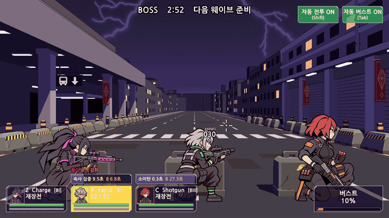
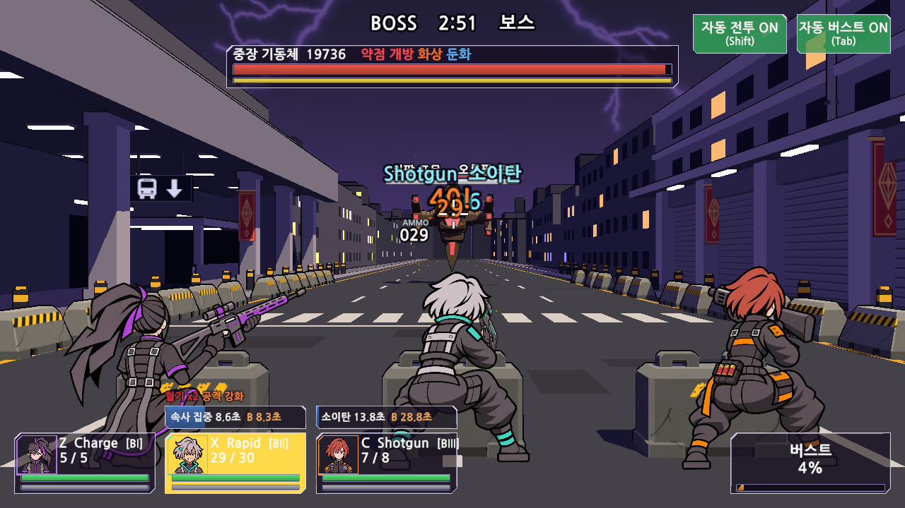
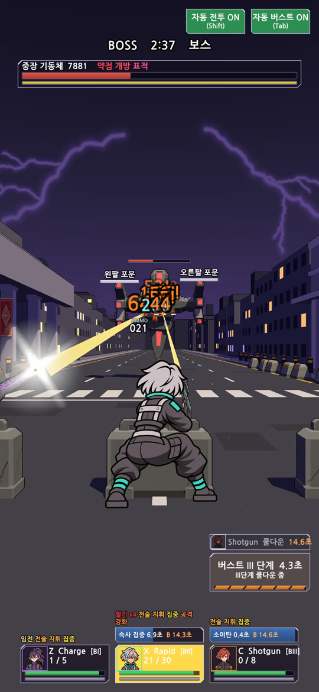

# Aim Combat Slice

엄폐 뒤에서 조준해 쏘는 3인 분대 전투 한 판을 만든 Unity 전투 클라이언트 프로토타입입니다. 조준과 무기 3종, 스킬과 단계형 버스트, 버프와 상태효과, 보스 부위 파괴와 패턴 저지, 타격감 연출을 한 판 안에 넣었습니다. 아군은 2D 일러스트, 적과 배경은 3D입니다.



| 전투 (PC 가로) | 전투 (휴대폰 세로) |
|---|---|
|  |  |

| 버스트 컷인 | 스킬 세트 선택 |
|---|---|
|  |  |

## 한 판의 구성

```text
Boot(로딩 화면) → 전투 씬 → 스킬 세트 선택 → 웨이브 1, 2 → 보스 등장 연출 → 보스전 → 결과(누르거나 R 키로 다시 시작)
```

- 아군 3명(차지형, 연사형, 산탄형)이 엄폐물 뒤에 있고, 고른 한 명을 직접 조준해 쏩니다. 나머지는 스스로 대상을 골라 쏩니다.
- 적은 다가와 엄폐물을 때리는 돌격형, 멀리서 쏘는 원거리형, 마지막 웨이브의 보스입니다.
- 승리는 제한 시간 안의 보스 처치, 패배는 아군 전원 전투 불능 또는 시간 초과입니다.

## 구현한 것

| 영역 | 내용 | 코드 |
|---|---|---|
| 조준과 사격 | 마우스와 터치 드래그를 같은 입력 계층으로 받습니다. 무기마다 사격 방식(연사 퍼짐, 차지 충전과 관통, 산탄 다발), 재장전, 엄폐가 다릅니다. 조준점은 무기별 모양과 잔탄을 함께 그립니다 | [Input](Assets/_Project/Scripts/Input), [Weapons](Assets/_Project/Scripts/Weapons), [Squad](Assets/_Project/Scripts/Squad) |
| 피해 계산과 상태효과 | 계산은 엔진에 의존하지 않는 Core 어셈블리에 있습니다. 고정소수점과 결정적 난수로 같은 입력이면 같은 결과가 나옵니다. 상태효과는 중첩, 갱신, 최댓값, 지속 피해, 행동 불가와 보스 저항 게이지 규칙을 따릅니다 | [Core](Assets/_Project/Scripts/Core) |
| 스킬과 버스트 | 캐릭터마다 스킬 1, 스킬 2, 버스트 묶음 2세트를 데이터 에셋으로 두고 전투 전에 고릅니다. 버스트는 캐릭터 고유 단계(I, II, III)를 차례로 쓰고 III 단계에서 풀 버스트로 넘어갑니다. 두 번째 세트는 코드 수정 없이 데이터만으로 만들었습니다 | [Skills](Assets/_Project/Scripts/Core/Combat/Skills), [Data](Assets/_Project/Data) |
| 보스 | 탄막, 강타 예고와 돌진, 그로기 패턴. 양팔은 체력과 손상 단계가 있어 부서지고, 강타 예고 때 저지 표적을 모두 깎으면 패턴이 취소됩니다 | [Battle](Assets/_Project/Scripts/Battle) |
| 타격감 | 히트스톱, 카메라 흔들림, 툰 셰이더에 통합한 피격 플래시, 명중 불꽃과 탄피, 피해 숫자. 무기별 프리셋 에셋으로 조절하고 F1 튜닝 패널(에디터)에서 실행 중에 바꿔 저장합니다. F2 로 연출을 끄면 같은 장면을 연출 없이 볼 수 있습니다 | [Feel](Assets/_Project/Scripts/Feel) |
| 연출 | 버스트 컷인과 보스 등장 연출은 Timeline 에셋 하나씩이 움직임을 정하고 코드는 그림, 글, 색만 넣습니다. 보스 등장 중에는 게임 시간을 멈추고 카메라가 보스를 비춥니다 | [BurstCutIn](Assets/_Project/Scripts/Feel/BurstCutIn.cs), [BossIntro](Assets/_Project/Scripts/Feel/BossIntro.cs) |
| UI 와 해상도 | UI 스택(화면, 팝업, 공유 Dim)은 [unity-ui-system](https://github.com/Frenil-client/unity-ui-system) 패키지를 씁니다. 캔버스의 짧은 변을 늘 1080 으로 맞추고, 안전 영역 아래에서 가로형과 세로형 배치를 바꿉니다 | [UI](Assets/_Project/Scripts/UI) |
| 리소스 관리 | 씬, 캐릭터, 적, 데이터, UI 팝업을 Addressables 로 불러옵니다. 씬마다 필요한 리소스 목록을 두고, 씬을 옮길 때 다음 씬이 쓰는 것은 남기고 나머지만 반환합니다. 다시 시작은 다시 불러오지 않습니다 | [Content](Assets/_Project/Scripts/Content) |
| 빌드 | Jenkins 파이프라인이 무결성 검사, 플랫폼별 Addressables 빌드, Windows 개발 빌드와 APK 를 만듭니다 | [Jenkinsfile](Jenkinsfile), [ci](ci) |

## 리소스를 불러오는 방식

빌드 설정에는 `Boot` 씬 하나만 있습니다. Boot 가 Addressables 를 준비하고 전투 씬을 주소로 엽니다. 전투 씬에는 배경과 관리자(분대, 전투 감독, HUD)만 꺼진 채 저장돼 있고, 씬이 열리면 캐릭터와 적, 데이터를 꽂은 뒤 켜집니다.

| 씬 | 기초 리소스 목록 |
|---|---|
| 전투(`Battle`) | 캐릭터 프리팹 3개(계속 유지), 스킬 구성, 얼굴과 컷인 그림, 적 3종, 타격감 데이터 |
| 사격장(`SampleScene`) | 캐릭터 프리팹 3개(계속 유지) |

에디터에서 처음 실행, 다시 시작, 사격장 전환을 차례로 돌린 결과입니다.

| 단계 | 로딩 화면 | 새로 불러옴 | 보유 |
|---|---|---|---|
| 처음 실행(Boot → 전투) | 뜸 | 20개 | 19개 |
| 다시 시작(전투 → 전투) | 안 뜸 | 0개 | 19개 |
| 사격장으로(전투 → 사격장) | 안 뜸 | 0개 | 3개(16개 반환) |


로딩 화면은 앱 본체에 들어가는 Boot 씬에 있어 번들 리소스를 쓰지 않습니다. 그룹은 Scenes, Characters, Enemies, Data, UI, Shared(글꼴, 셰이더, HUD 그림, 배경) 여섯 개이고 모두 앱에 들어가는 로컬 그룹입니다. 배포 설정과 빌드 검사는 [unity-lobby-flow](https://github.com/Frenil-client/unity-lobby-flow) 의 `com.frenil.addressables-delivery` 패키지를 씁니다.

## 해상도 대응

| 가로형 | 세로형 |
|---|---|
|  |  |

- 캔버스 배율은 화면 방향에 따라 기준 해상도를 돌려, 가로든 세로든 짧은 변이 1080 입니다.
- 안전 영역의 가로세로 비가 1.3 보다 작으면 세로형 배치를 씁니다. 아군 열은 아래 가운데, 버스트 열은 그 위 오른쪽, 스킬 세트 선택은 열을 아래로 쌓고 끌어서 내려 봅니다.
- 세로 화면에서는 카메라가 가로 화각 34도를 지키도록 세로 화각을 넓힙니다(최대 68도).

## 실행

Unity 6000.3.9f1(URP)에서 프로젝트를 열고 `Assets/Scenes/Boot.unity` 를 실행합니다. 전투 씬(`Battle.unity`)을 바로 실행해도 되며, 이때는 로딩 화면 없이 씬이 스스로 리소스를 불러옵니다.

| 조작 | 키 | 터치 |
|---|---|---|
| 조준, 사격 | 마우스 누른 채 이동 | 드래그 |
| 아군 전환 | Z, X, C | 아군 초상 |
| 버스트 | 숫자 1-5(후보 순서), Q(첫 후보) | 후보 버튼 |
| 자동 전투, 자동 버스트 | 왼쪽 Shift, Tab | 화면 위 버튼 |
| 연출 켜고 끄기, 튜닝 패널(에디터) | F2, F1 | |
| 다시 시작(결과 화면) | R | 화면 아무 곳 |

실행 파일을 직접 만들 때는 **Tools ▸ Addressables Delivery ▸ 빌드 창**에서 Addressables 를 먼저 빌드합니다. 플레이어 빌드가 Addressables 를 함께 빌드하지 않도록 설정돼 있습니다. Jenkins 로는 `TARGET`(both, Windows, Android)과 `STEPS`(addressables+player, addressables)를 골라 실행합니다.

## 확인한 범위

| 대상 | 확인 결과 |
|---|---|
| 에디터 자동 플레이 | 가로, 세로(1080x2340) 화면에서 한 판(웨이브 2개와 보스) 승리까지 오류 0 |
| Android | Jenkins 로 만든 APK 를 블루스택(Android 에뮬레이터)에서 가로, 세로 모드로 플레이 |
| Windows | 개발 빌드에서 Boot, 로딩, 전투 씬 준비 완료까지 오류 없음(로그) |
| Jenkins | 무결성 검사, Windows 와 Android 의 Addressables 빌드와 플레이어 빌드, 산출물 보관 |
| 리소스 수명 | 처음 실행, 다시 시작, 사격장 전환의 로드와 반환 수(위 표) |

## 남은 것

- 타격감 적용 전후 비교 영상(F2 로 연출을 끈 판과 켠 판)
- 대량 상황(탄환, 이펙트, 적이 많은 장면)의 Android 실기기 프레임 시간과 GC 할당 측정
- 전투 규칙 테스트. Core 의 일부 규칙은 dotnet 테스트([Tests](Tests))가 있고, 나머지는 게임 기능을 정리한 뒤 추가합니다

## 리소스 출처와 작업 범위

| 대상 | 출처 |
|---|---|
| 아군 일러스트(포즈, 얼굴, 컷인) | GPT 이미지 생성 뒤 보정. 규격과 목록은 [RESOURCES.md](RESOURCES.md) |
| 돌격형, 원거리형 적 3D 모델 | Tripo3D 로 생성 |
| 보스, 엄폐물, 배경 3D 모델 | Blender MCP 로 Blender 에서 생성. 원본 Blender 파일과 텍스처는 [ArtSource/Models](ArtSource/Models) |
| 글꼴 | 나눔고딕 Bold(SIL OFL, [라이선스](Assets/_Project/Art/Fonts/OFL.txt)), TextMesh Pro 기본 글꼴 |
| 사운드 | 실행할 때 합성하는 임시음 |

전투 규칙, 수치, 화면 구성과 각 단계의 완료 기준은 [SPEC.md](SPEC.md)와 [PLAN.md](PLAN.md)에 직접 정했습니다. AI(Claude Code)는 구현과 반복 확인(자동 플레이 캡처, 각도와 리소스 수 측정), CI 와 문서 초안에 활용했습니다.

니케의 전투 메커니즘과 화면 구성 방식(2D 아군, 3D 적과 배경)을 참고했고, 이름, 캐릭터, 디자인은 자체로 만들었습니다.
